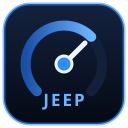

# Jeep Computer

A custom in-dash digital dashboard, telemetry system, and active audio DSP suite for a 1979 Jeep CJ-7, powered by a Raspberry Pi 5.



---

## Overview

The Jeep Computer replaces traditional mechanical instrumentation with a modern, touch-driven digital cockpit built on Python, Qt Wayland (PySide6), and CamillaDSP. It integrates engine telemetry, environmental weather logging, intelligent power management, Apple CarPlay, and an active multi-channel audio DSP pipeline into an off-road-hardened platform.

---

## Key Features

### 1. Digital Dashboard & Telemetry
- **Touch UI:** Hardware-accelerated Qt 6 Wayland interface tailored for automotive touchscreens.
- **Engine Gauges:** Real-time RPM, coolant temperature, oil pressure, battery voltage, and running hours.
- **Custom Tach Circuit:** Optoisolated pulse conditioning for high-energy ignition (HEI) distributor spikes (up to 400V) conditioned to safe 3.3V GPIO pulses.
- **Inclinometer & Pitch/Roll:** Visual vehicle attitude display with customizable calibration offsets.

### 2. High-Fidelity Active Audio DSP
- **CamillaDSP Engine:** Real-time 8-channel active crossover and parametric EQ running low-latency over ALSA/USB audio.
- **Stem Player Integration:** In-car stem player supporting AI-separated music tracks (vocals, bass, drums, melody) with per-channel spatial balancing.
- **Amplifier Power Management:** Automated remote turn-on controller with signal-sensing anti-pop protection and idle timeouts.

### 3. Environmental & Weather Station
- **Offline Meteorological Logging:** Onboard barometric pressure, temperature, humidity, and lightning detection.
- **Station Mode:** Automatically transitions to a low-power logging station when parked, tracking trends without draining the starter battery.
- **Local Web Interface:** Built-in web server providing real-time telemetry and diagnostics to smartphones over the vehicle's onboard Wi-Fi hotspot.

### 4. Power & Battery Management
- **Hardware UPS (X1209):** Intelligent power monitoring with graceful shutdown, key-switch (ACC) sensing, and battery voltage protection.
- **Deep Sleep & Duty Cycling:** Configurable sleep intervals and wake alarms to maintain system state while conserving vehicle battery power.

---

## Architecture

```
                       +-----------------------+
                       |    Raspberry Pi 5     |
+-------------------+  |                       |  +--------------------+
| Vehicle Sensors   |->|  • Qt Wayland UI      |->| Touch Display      |
| • HEI Tachometer  |  |  • Sensor Manager     |  +--------------------+
| • ADS1115 ADC     |  |  • CamillaDSP (ALSA)  |  +--------------------+
| • Weather Sensors |  |  • Web Dashboard      |->| Multi-Channel Amp  |
+-------------------+  |  • UPS Power Monitor  |  +--------------------+
                       +-----------------------+
```

---

## Repository Structure

- `dashboard/` - Qt/PySide6 user interface, gauges, widgets, and navigation pages.
- `audio/` - CamillaDSP integration, websocket client, and audio routing.
- `sensors/` - Hardware sensor drivers (ADC, HEI tachometer, temperature, pressure).
- `weather/` - Weather station engine, SQLite logging, and atmospheric trend analysis.
- `system/` - Systemd service units, CamillaDSP configs, and Wayland compositor configuration.
- `docs/` - Circuit schematics, hardware bill of materials, and wiring diagrams.
- `tools/` - Diagnostic scripts, calibration utilities, and backup tools.
- `web/` - Lightweight Flask/FastAPI telemetry server for mobile access.

---

## Documentation

- [Hardware & Pinout Guide](docs/hardware.md)
- [Tachometer Interface Circuit](docs/circuits/README.md)
- [Audio & Stem Processing Architecture](docs/stems.md)
- [Power Management & UPS Configuration](docs/ups-always-on.json)

---

## License

MIT License. Designed and engineered by Colton Zutavern.
